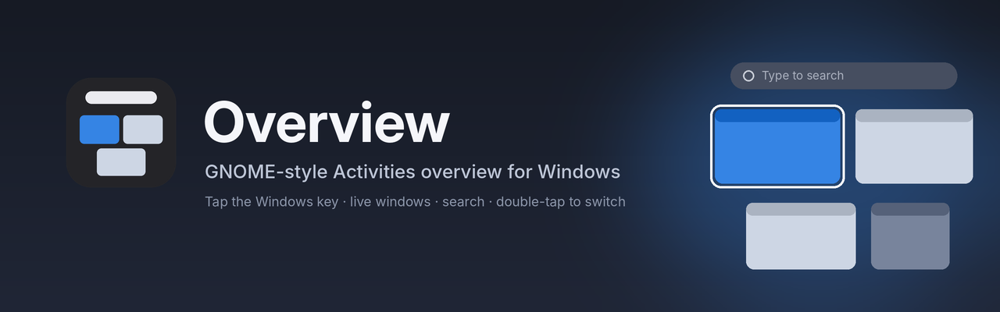
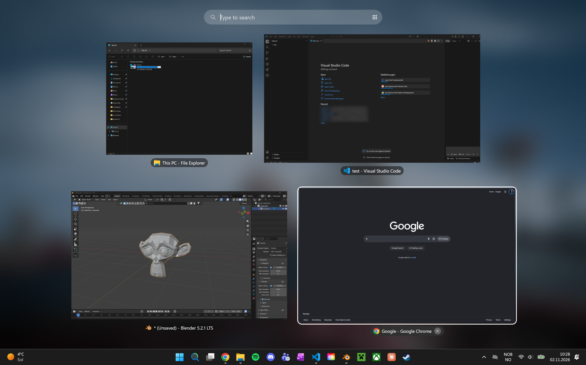
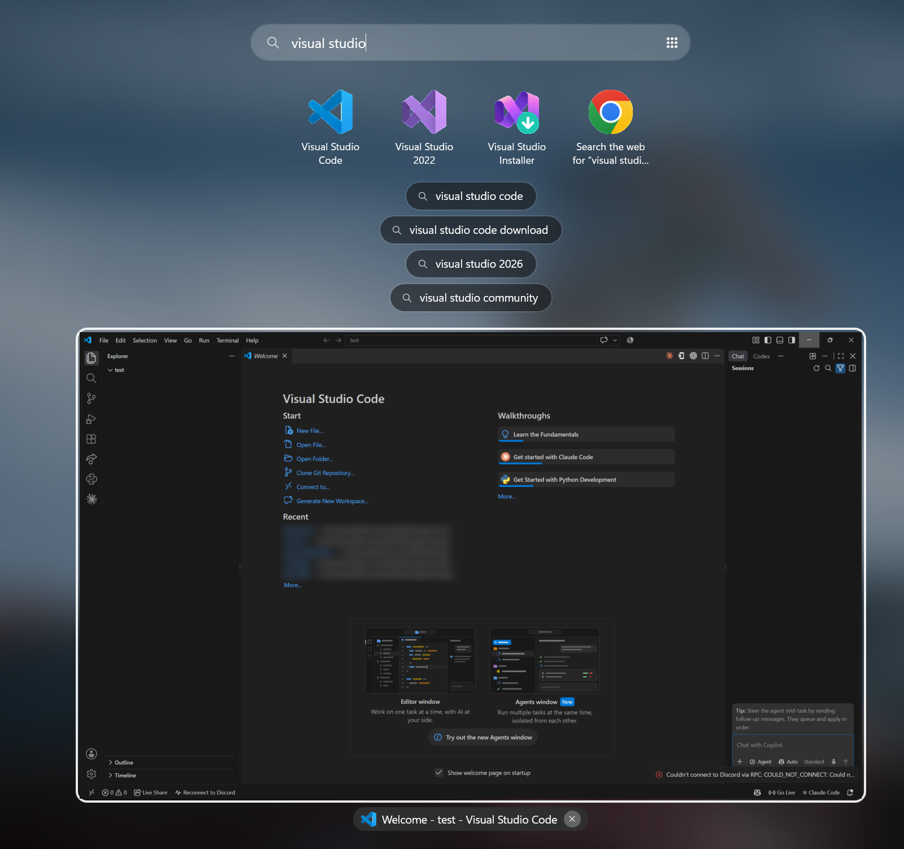
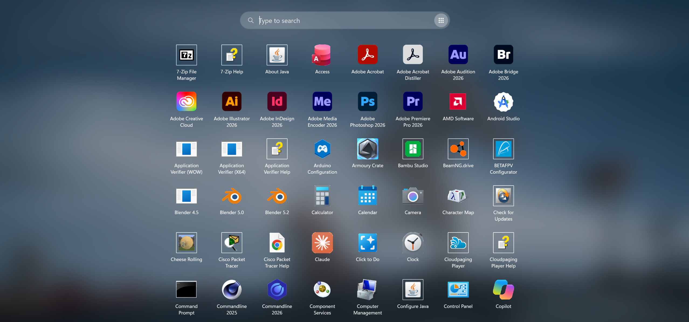
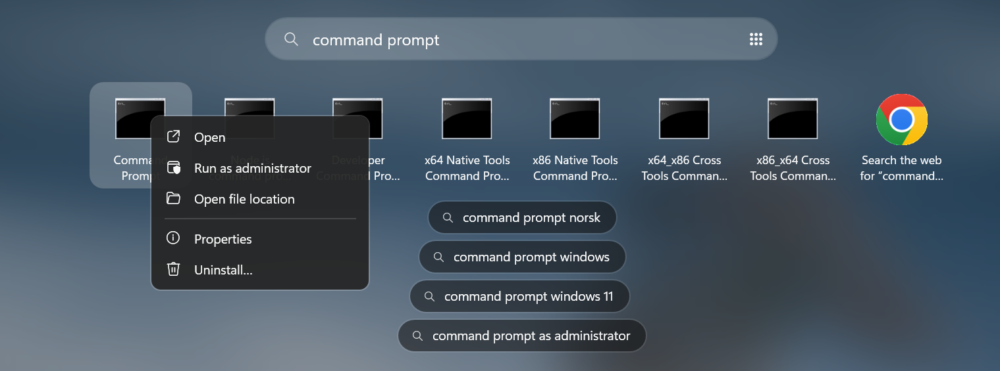
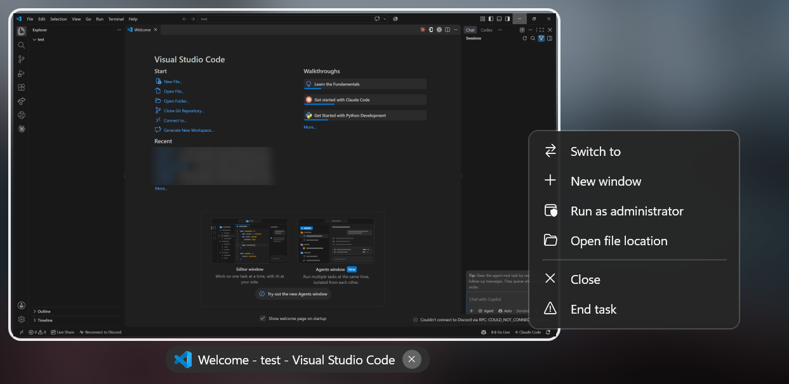

<p align="center">
  
</p>

<p align="center">
  <a href="https://github.com/Hoppsann/GNOME-overview-for-windows/releases/latest"></a>
  
  
</p>

**Overview** brings GNOME's Activities overview to Windows. Tap the Windows key and every open window
zooms out into a live grid with a search bar on top. Find a window, launch an app or search the web,
then tap the Windows key again to jump straight there.

<p align="center">
  
</p>

## Features

- **One key.** A lone tap of the Windows key opens the overview. Win+E, Win+Shift+S and every other
  Windows shortcut keep working.
- **Live windows.** Thumbnails are live, not screenshots. Videos keep playing and chats keep scrolling.
- **Alt+Tab, but better.** The window you used before the current one is highlighted when the overview
  opens, so a **double-tap** of the Windows key flips between your last two windows.
- **Search everything.** Typing filters your open windows and shows matching installed apps
  (desktop and Microsoft Store). Fuzzy matching works: `vsc` finds Visual Studio Code.
- **Web search.** If nothing on your PC matches, press Enter to search in your default browser with
  its own search engine. Suggestions appear while you type.
- **App grid.** The ⋮⋮⋮ button at the end of the search bar shows every installed app.
- **Right-click menus.** Run as administrator, open file location, properties, new window, end task.
- **Keyboard first, mouse friendly.** Arrows, Tab and the scroll wheel move the selection, and clicks
  work as you'd expect.
- **Stays out of the way.** The taskbar stays visible, and the Start button still opens Start.

<table>
  <tr>
    <td width="50%"></td>
    <td width="50%"></td>
  </tr>
  <tr>
    <td align="center"><b>Search</b>: apps, windows and web suggestions</td>
    <td align="center"><b>App grid</b>: everything you have installed</td>
  </tr>
  <tr>
    <td width="50%"></td>
    <td width="50%"></td>
  </tr>
  <tr>
    <td align="center"><b>Right-click an app</b>: run as admin and more</td>
    <td align="center"><b>Right-click a window</b>: new window, close, end task</td>
  </tr>
</table>

## Install

1. Download **`Overview-Setup.exe`** from the [latest release](https://github.com/Hoppsann/GNOME-overview-for-windows/releases/latest).
2. Run it and choose:
   - **Start with Windows**
   - **Check for updates automatically**
   - **Desktop shortcut**
3. Tap the Windows key.

Setup installs for your user only (no admin needed) and adds Overview to the Start menu and to
**Settings → Apps → Installed apps**, where you can uninstall it like any other app.

Prefer not to install? Download **`Overview-standalone.exe`** and run it from anywhere. It never
checks for updates.

> [!NOTE]
> The exe isn't code-signed yet, so Windows SmartScreen may warn the first time.
> Click **More info → Run anyway**.

## Updates

If you ticked **Check for updates** during setup, Overview checks this repo's
[Releases](https://github.com/Hoppsann/GNOME-overview-for-windows/releases) when it starts and twice a
day after that. When a new version is out, it asks first. Say yes and it downloads, installs and
restarts in a few seconds, keeping your settings. You can also check by hand, or switch automatic
checks on or off, from the tray menu.

## How to use

| Do this | To |
| --- | --- |
| Tap **Windows** | Open the overview |
| Tap **Windows** again | Switch to the highlighted window |
| **Double-tap Windows** | Jump back to your previous window |
| Type | Search windows, apps and the web |
| **Enter** | Open the selected window, app or search |
| **Arrows / Tab / scroll wheel** | Move the selection (Tab goes left to right, row by row) |
| **Esc** | Clear the search, then close without switching |
| **Backspace** (empty search) | Close the selected window (the app can still ask to save) |
| **Del** (empty search) | Force-close the selected app |
| **Right-click** or **Menu key** | More actions for the selected window or app |
| Middle-click or **×** | Close a window |

Right-click the tray icon to turn off the Windows-key trigger, enable a top-left hot corner,
turn web suggestions on or off, check for updates, or set Overview to start with Windows.

## Privacy

Overview runs entirely on your PC. It only goes online for two things, and you can turn both off:

- **Web search suggestions.** While suggestions are on, what you type is sent to your browser's search
  engine (Google, Bing or Brave), the same as typing in the browser's address bar. Turn this off in the tray menu.
- **Update checks**, if you chose them during setup. These only contact GitHub.

Settings and a small log are stored in `%APPDATA%\Overview`.
"Start with Windows" uses a Task Scheduler task that runs at sign-in (it starts sooner than the
Startup list), or the Startup list if the task can't be created. The exe unpacks itself once to
`%TEMP%\.net\Overview` so later starts are faster.

## Known limitations

- Windows hides key presses from normal apps while an **admin window** has focus, so the Windows key
  opens Start there instead.
- **Minimized windows** show their last frame, because Windows doesn't let them draw.
- With taskbar **auto-hide** on, the taskbar stays hidden until you point at the bottom of the screen,
  same as always. Windows 11 doesn't let apps show it on their own. The overview keeps that strip free,
  so the taskbar slides up on top of it.
- The overview opens on the monitor your mouse is on.

## Build from source

You need the [.NET 8 SDK](https://dotnet.microsoft.com/download/dotnet/8.0). In PowerShell:

```powershell
git clone https://github.com/Hoppsann/GNOME-overview-for-windows.git
cd GNOME-overview-for-windows
./build.ps1
```

This creates `dist/Overview-Setup.exe` and `dist/Overview-standalone.exe`. They are the same
program: when the file name contains "Setup", it runs as the installer.

Releases are automatic: when the `<Version>` in `src/Overview/Overview.csproj` changes on `main`,
the [Release workflow](.github/workflows/release.yml) builds both exes on Windows and publishes them
as a GitHub Release, using `.github/release-notes.md` as the description. Installed copies with
updates turned on pick it up from there.

<details>
<summary><b>How it works</b></summary>

| File | What it does |
| --- | --- |
| `KeyboardHook.cs` | Low-level keyboard hook that detects a lone Windows-key tap and masks it so Start doesn't open |
| `WindowEnumerator.cs` | Lists Alt+Tab-style windows with app names and icons |
| `OverviewWindow.cs` | The overview itself: DWM live thumbnails, animation, search, keyboard and mouse |
| `Layout.cs` | GNOME-like row packing that keeps windows' relative sizes |
| `AppCatalog.cs` | All installed apps from `shell:AppsFolder` (desktop and Store) |
| `Search.cs` | Fuzzy matching: prefix, word start, acronym, substring |
| `WebSearch.cs` / `WebSuggest.cs` | Default-browser web search and search suggestions |
| `ShellActions.cs` | Right-click actions: run as admin, file location, properties |
| `Launcher.cs` | Starts apps, folders and searches on a separate thread so the overview never freezes |
| `Mru.cs` | Most-recently-used window order for the Alt+Tab-style switching |
| `HotCorner.cs` | Optional top-left hot corner |
| `Installer.cs` / `SetupWindow.cs` | Setup wizard, install, update and uninstall |
| `Updater.cs` | Checks GitHub Releases and downloads new versions |

</details>
